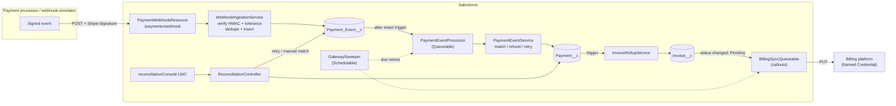

# Salesforce Integration Gateway

[](https://github.com/tatitoxt/salesforce-integration-gateway/actions/workflows/ci.yml)

An SFDX project (Apex + Lightning Web Components) that receives signed payment webhooks in Salesforce, processes them idempotently and asynchronously, reconciles payments against invoices, syncs invoice status to a billing platform, and gives operators a console for the exceptions.

> **Apex execution status:** the Apex code and its 75 test methods have **not** been executed against a Salesforce org in this repository's history. No Dev Hub / SFDX auth URL was available while building it. CI runs the `apex-org` job (deploy + `RunLocalTests` with coverage) **only when an `SFDX_AUTH_URL` repository secret is configured**; otherwise it is skipped with a notice. What _is_ verified on every push: LWC Jest tests, simulator unit/integration/E2E tests, ESLint, Prettier (including Apex syntax via `prettier-plugin-apex`), Salesforce Code Analyzer (PMD) and `npm audit`.

## Problem

Payment processors deliver events (payment succeeded, refund created) as signed HTTP webhooks. A CRM that consumes them has to:

- reject forged or replayed requests,
- tolerate duplicate and out-of-order deliveries,
- respond fast and do the real work asynchronously, with retries,
- apply partial payments and refunds to the right invoice,
- surface anything it cannot match to a human, and
- keep the billing system in sync without losing updates when it is down.

## What it does today

| Area             | Implementation                                                                                                                                                                                                                                                                                                                                                                                                                                                                                                                                                   |
| ---------------- | ---------------------------------------------------------------------------------------------------------------------------------------------------------------------------------------------------------------------------------------------------------------------------------------------------------------------------------------------------------------------------------------------------------------------------------------------------------------------------------------------------------------------------------------------------------------- | ---------------------------- | --------------------------- |
| Webhook endpoint | `POST /services/apexrest/payments/webhook` (`PaymentWebhookResource`)                                                                                                                                                                                                                                                                                                                                                                                                                                                                                            |
| Authentication   | `Stripe-Signature: t=<unix>,v1=<hex>` HMAC-SHA256 over `"<t>.<raw body>"`, constant-time compare, 300 s timestamp tolerance, multiple `v1` values for secret rotation (`WebhookSignatureVerifier`)                                                                                                                                                                                                                                                                                                                                                               |
| Secret storage   | Protected hierarchy custom setting `Payment_Gateway_Settings__c`; missing secret fails closed with HTTP 503 ([ADR 0001](docs/adr/0001-protected-custom-setting-for-signing-secret.md))                                                                                                                                                                                                                                                                                                                                                                           |
| Idempotency      | Unique `Payment_Event__c.External_Event_Id__c`; duplicates return HTTP 200 `duplicate` (including concurrent-insert races); payments are also unique by `External_Payment_Id__c`                                                                                                                                                                                                                                                                                                                                                                                 |
| Async processing | `PaymentEventProcessor` Queueable, 50 events per run (bounded by heap; payloads are capped at 64 KB), exponential backoff `2^attempts` minutes capped at 60, `Dead_Letter` after `Max_Event_Attempts__c`; a `System.Finalizer` (`PaymentEventRetryFinalizer`) re-enqueues the processor immediately when the job dies on an unhandled exception or governor limit — bounded at 3 consecutive crashes — and `GatewaySweeper` schedulable stays as the safety net ([ADR 0002](docs/adr/0002-async-processing-and-retry.md))                                        |
| Domain           | `Invoice__c`, `Payment__c` (payments, refunds and disputes), matching by invoice number with an exact-amount fallback (single payable invoice at the payment's currency + outstanding balance), partial payments, overpayments, refunds linked to the original payment, disputes recorded against the original payment for review and resolved on `charge.dispute.closed` (won → applied, lost → still flagged), `invoice.paid` events reconciled against the local balance, currency checks, invoice roll-ups (`Open` / `Partially_Paid` / `Paid` / `Overpaid`) |
| Exceptions queue | Events end in `Needs_Review` with a reason code (`INVOICE_NOT_FOUND`, `CURRENCY_MISMATCH`, `OVERPAYMENT`, `REFUND_EXCEEDS_PAYMENT`, …), `Retry_Scheduled` or `Dead_Letter`                                                                                                                                                                                                                                                                                                                                                                                       |
| Billing sync     | `BillingSyncQueueable` → `PUT callout:Billing_Platform/v1/invoices/{number}/payment-status` with an `Idempotency-Key`; 408/429/5xx/timeouts retried with backoff, other 4xx marked `Failed`                                                                                                                                                                                                                                                                                                                                                                      |
| Console          | `reconciliationConsole` LWC: filter the queue, inspect the pretty-printed payload and payments, retry, search open invoices, get amount-based match suggestions (`suggestInvoices` ranks open same-currency invoices by                                                                                                                                                                                                                                                                                                                                          | Balance_Due − payment amount | , top 5) and manually match |
| Layering         | One trigger per object → `TriggerHandler` subclasses → services → selectors; collection-based, fixed query/DML count per batch ([ADR 0003](docs/adr/0003-layering.md))                                                                                                                                                                                                                                                                                                                                                                                           |
| Simulator        | `webhook-simulator` Node CLI: synthetic scenarios, signing, sending, and a local mock receiver that mirrors the endpoint's synchronous contract                                                                                                                                                                                                                                                                                                                                                                                                                  |

Requirements and acceptance scenarios: [docs/spec/README.md](docs/spec/README.md).

## Architecture



The HTTP request only verifies, de-duplicates and stores the event (HTTP 202). Matching and callouts run in Queueables. A Queueable may enqueue a single child job, so each job chains at most one follow-up (more backlog, then billing sync, then a delayed retry of up to 10 minutes). If the job itself crashes — including governor-limit deaths no catch block can see — its transaction finalizer re-enqueues it at once with a bounded crash depth, and the sweeper picks up anything else.

## Quickstart

Requirements: Node 22 (see `.nvmrc`). Salesforce CLI and an org are only needed for the org deployment section.

```bash
git clone https://github.com/tatitoxt/salesforce-integration-gateway.git
cd salesforce-integration-gateway
npm ci
npm test            # LWC Jest + simulator unit/integration tests
npm run test:e2e    # spawns the CLI receiver and sender as separate processes
```

### Demo without an org (local mock receiver)

The mock receiver implements the endpoint's synchronous contract (fail-closed secret, signature, tolerance, idempotency, status codes). It does **not** run the Apex matching logic.

```bash
# terminal 1
WEBHOOK_SECRET=whsec_local_demo npm run simulate -- serve --port 8787

# terminal 2
export WEBHOOK_SECRET=whsec_local_demo
URL=http://127.0.0.1:8787/services/apexrest/payments/webhook
npm run simulate -- scenarios
npm run simulate -- send --url $URL --scenario full-payment   # 202 accepted
npm run simulate -- send --url $URL --scenario duplicate      # 202 accepted, then 200 duplicate
npm run simulate -- send --url $URL --invoice INV-1 --tamper  # 401 rejected (signature_mismatch)
npm run simulate -- send --url $URL --bulk 200 --json
```

### Deploy to a scratch org (requires a Dev Hub)

```bash
sf org login web --set-default-dev-hub --alias devhub
sf org create scratch --definition-file config/project-scratch-def.json --alias gateway --set-default
sf project deploy start --source-dir force-app
sf org assign permset --name Integration_Gateway_Admin
sf apex run test --test-level RunLocalTests --code-coverage --result-format human --wait 30
sf apex run --file scripts/apex/demo-data.apex
# Edit a local copy of scripts/apex/configure-secret.apex with your own secret, then run it.
```

To receive real HTTP traffic, expose the Apex REST endpoint to an integration user (for example via an External Client App / connected app and OAuth) with the `Integration_Gateway_Webhook_User` permission set, then point the simulator at `https://<my-domain>.my.salesforce.com/services/apexrest/payments/webhook` with a bearer token header. That setup is environment-specific and not automated here. Configure the `Billing_Platform` Named Credential URL and External Credential API key in Setup; no credentials are stored in the repo.

## Tests

| Suite                                                                                  | Command                                                               | Count (measured locally)                            |
| -------------------------------------------------------------------------------------- | --------------------------------------------------------------------- | --------------------------------------------------- |
| LWC Jest (`reconciliationConsole`)                                                     | `npm run test:lwc`                                                    | 13 tests, 98% statements / 87% branches             |
| Simulator unit + integration (HTTP against the mock receiver, incl. a 200-event batch) | `npm run test:simulator`                                              | 23 tests                                            |
| Simulator E2E (real CLI entrypoint, two processes)                                     | `npm run test:e2e`                                                    | 1 test                                              |
| Lint / format                                                                          | `npm run lint`, `npm run format:check`                                | —                                                   |
| Apex (PMD)                                                                             | `sf scanner run --target force-app/main/default/classes --engine pmd` | 0 findings of severity 1–2                          |
| Apex tests                                                                             | `sf apex run test --test-level RunLocalTests` (needs an org)          | 75 test methods in 10 classes, **not executed yet** |

Apex test classes cover: valid webhook (202 + async processing), bad signature, stale timestamp, missing secret (503), duplicate events, payload validation, matching, partial payments, overpayment, currency mismatch, refunds, refund-before-payment retry with backoff and dead-letter, billing sync via `HttpCalloutMock` (200, 503, 429/timeout, 422, max attempts), a 200-record bulk run with query/DML count assertions, the reconciliation controller, trigger bypass, the sweeper, the crash-recovery finalizer (success is a no-op, crash requeues with depth, depth cap stops requeueing), and a billing-API
contract suite (`BillingContractTest`: PUT/JSON + idempotency key, exact body
schema, URL-encoded invoice number, key stability/payment sensitivity and the
external-id response field).

## CI

`.github/workflows/ci.yml` runs on every pull request and on pushes to `main`:

- **node**: `npm ci`, ESLint, Prettier check, LWC Jest with coverage thresholds, simulator tests, simulator E2E, `npm audit --audit-level=high`.
- **code-analyzer**: Salesforce CLI + Code Analyzer (PMD) on Apex classes and triggers; fails on severity 1–2 findings.
- **apex-org**: authenticates with the `SFDX_AUTH_URL` secret, creates a scratch org, deploys, runs `RunLocalTests` with coverage and deletes the org. **Skipped when the secret is not configured.**

## Limitations

- Apex has not been compiled or run in an org from this repo yet (see the status note at the top). Code Analyzer and Prettier parse it, which is not the same as compiling.
- The webhook endpoint requires an authenticated Salesforce session (integration user). Exposing it anonymously through a Salesforce Site is out of scope.
- Protected custom settings only hide the secret from subscribers of a managed package; in an unmanaged deployment admins can still read it.
- `payment_intent.succeeded`, `refund.created`, `charge.dispute.created`, `charge.dispute.closed` and `invoice.paid` are interpreted; other event types are stored and marked `Ignored`. `invoice.paid` creates no payment record — it is a reconciliation signal only.
- Matching uses `metadata.invoice_number`, then a conservative amount fallback: a payment with no invoice reference is auto-applied only when exactly one payable invoice in its currency has the same outstanding balance (`Match_Method__c = Exact_Amount`); ambiguous or empty candidate sets still go to the exceptions queue. No fuzzy matching.
- Multi-currency conversion is not supported; mismatched currencies go to the exceptions queue.
- Billing sync pushes status only and assumes a simple REST contract; the Named Credential URL is a placeholder (`https://billing.example.com`).
- PMD findings of severity 3 (mainly ApexDoc and assertion-message rules, plus complexity warnings) are reported but do not fail CI.
- The local mock receiver mirrors the synchronous contract only; it is a demo and test aid, not a Salesforce emulator.

## Roadmap

- Run the Apex suite in CI against a scratch org and publish coverage.

## License

[MIT](LICENSE) © 2026 Fausto Pastura

## Benchmarks

`simulator/bin/benchmark.js` pushes signed webhooks through the full receiver contract over HTTP: **4,089 events/sec** verified, 1.43 ms p50, and **100% dedup** on a 2,000-event replay — retries never double-create records. See [docs/benchmarks.md](docs/benchmarks.md).
